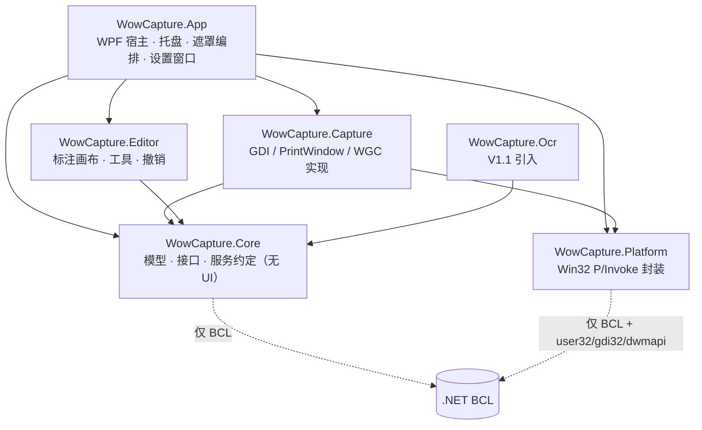
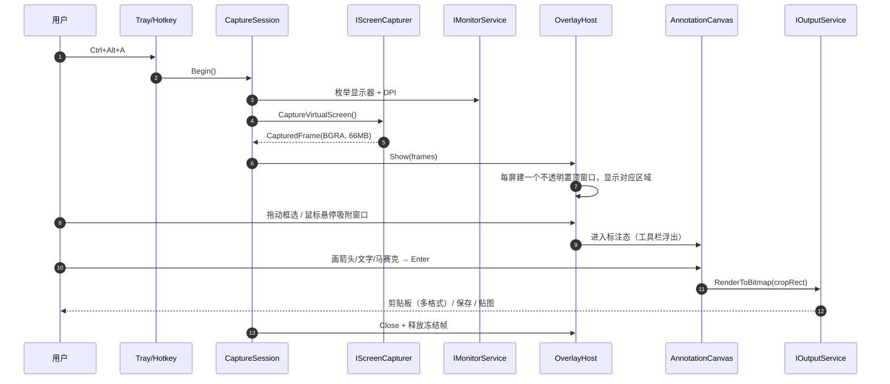

# WowCapture 架构设计

> 状态：设计稿 v1（2026-11）
> 目标读者：我自己，以及未来的贡献者

## 1. 定位与约束

一句话：**一个按热键、0.2 秒内出图的 Windows 截图工具，截完就能改、就能贴、就能发。**

约束决定了几乎所有技术选择：

| 约束 | 推论 |
|---|---|
| 自用为主 | 只做 Windows；不做账号、云同步、跨平台 |
| 开源可维护 | 单人可读完全部代码；模块边界清晰；核心逻辑可单测 |
| 作者熟悉 C# | .NET 10 + WPF，不引入 C++ 工具链 |
| 常驻后台 | 启动 < 300ms，空载内存 < 80MB，无 Electron |
| 离线优先 | 除 AI 功能外全部本地处理；默认零遥测 |
| Win10 2004+ / Win11 | 可用 `Windows.Graphics.Capture`，但仍需保留 GDI 回退 |

**非目标**：视频剪辑、屏幕录制器、团队协作画布、macOS/Linux。

## 2. 技术选型

| 层 | 选择 | 理由 | 放弃的方案 |
|---|---|---|---|
| 运行时 | **.NET 10 (LTS)** | .NET 8 已于 2026-11 EOL；10 支持到 2028 | .NET 8、.NET Framework |
| UI | **WPF** | 成熟、无运行时依赖（随 Windows 一起在 WindowsDesktop 里）、矢量绘制/命中测试/DrawingVisual 保留模式齐全、PerMonitorV2 支持完整 | WinUI3（Windows App SDK 部署重、透明窗口难做、控件库仍在演进）；Avalonia（多一套运行时与渲染差异，对纯 Windows 工具是负债）；WinForms（绘制能力不足） |
| 抓屏 | GDI `BitBlt` → `PrintWindow` → `Windows.Graphics.Capture` 三级回退 | 一条路径不可能覆盖所有窗口 | 只上 WGC（Win10 早期版本不稳、需要 D3D 设备） |
| 图形处理 | `BitmapSource` + `DrawingVisual` | 零第三方依赖即可完成 1:1 像素管线 | SkiaSharp / ImageSharp（MVP 不需要） |
| 配置 | `System.Text.Json` + 手写 `SettingsStore` | 20 行代码，可原子写入 | Microsoft.Extensions.Configuration（重） |
| 历史 | SQLite（`Microsoft.Data.Sqlite`），仅 V1 引入 | 单文件、可迁移、支持 FTS 搜索 | JSON 索引（查询能力差） |
| MVVM | 先用原生 `INotifyPropertyChanged`，UI 复杂后引入 `CommunityToolkit.Mvvm` | 骨架阶段零依赖 | Prism / ReactiveUI（重） |
| 打包 | 框架依赖单文件 + 便携 zip | 2–3MB，开源分发友好 | 自包含（WPF 不可裁剪，约 80MB） |

> 依赖原则：**除非能省 200 行以上代码，否则不引 NuGet**。开源工具的价值密度取决于可读性。

## 3. 关键决策

### D1 冻结帧（Freeze-Frame）架构 —— 最重要的一条

按下热键的瞬间，**先把整个虚拟屏幕抓进内存一张 BGRA 位图**，然后遮罩窗口显示的是这张静态图，而不是真实桌面。

```
热键 → 抓整屏 → 冻结位图 → 遮罩窗口显示位图 → 用户在上面框选/标注 → 从位图裁剪
```

好处远多于代价：

1. **遮罩窗口可以完全不透明**。这是关键——WPF 的 `AllowsTransparency=true` 会强制窗口走软件渲染，并且和 DWM 合成路径打架，双 4K 面积上会掉帧、会撕裂。改用不透明窗口后，遮罩只是"画了一张全屏图片"，性能问题消失。
2. **不需要"隐藏窗口 → 等一帧 → 抓屏 → 再显示"**，彻底消除闪烁和时序竞争。
3. **智能吸附不会抓到自己**：选区矩形、高亮边框、工具栏全都画在冻结图上层，永远不会出现在最终结果里。
4. **截图内容与用户所见严格一致**：用户看到的就是他按下热键那一刻的画面。
5. 坐标系退化：所有标注都在同一张位图上做，像素就是像素，没有半像素对齐问题。

代价与缓解：

| 代价 | 量级 | 缓解 |
|---|---|---|
| 内存占用 | 双 4K ≈ 66MB（8192×2160×4B） | 只在截图会话期间持有，一次只允许一个会话 |
| 热键响应延迟 | BitBlt 30–60ms + 分配 66MB ~20ms | 见 D2 与性能预算，目标 < 200ms |
| 无法截取"按下热键之后才出现的画面" | — | 这本来就不是截图工具的需求；录屏/GIF 走另一条管线 |

### D2 每个显示器一个遮罩窗口

不做一个覆盖整个虚拟屏幕（比如 7680×2160、跨 DPI）的大窗口，而是**每块屏幕一个无边框置顶窗口，各自 1:1 显示该屏幕对应的冻结图片区域**。

原因：Per-Monitor V2 下每个 HWND 有自己的 DPI 上下文。跨 DPI 的超大窗口会被系统在 DWM 层面做一次拉伸，结果是模糊、偏移、点击命中错位——这是自研截图工具最常见的"看起来能用但就是不准"的根因。

由 `OverlayHost` 统一编排：鼠标在哪块屏幕就在哪块屏幕上处理拖选；拖出边界时用统一的虚拟屏坐标（`ScreenRect`）跨窗口绘制选区，其他窗口负责擦除。

### D3 坐标与 DPI 铁律

> **全链路只用物理像素（virtual-screen 坐标，左上角可以为负）。DIP 只出现在一处：给 WPF 窗口设尺寸。**

具体规则：

1. 进程清单声明 `PerMonitorV2`，则 `GetMonitorInfo`、`GetCursorPos`、`WindowFromPoint` 返回的都是物理像素，可直接互算。
2. 遮罩窗口的物理尺寸用 `SetWindowPos` 设置；同时把 WPF 的 `Width/Height` 设为 `物理尺寸 / dpiScale`（DIP）。这样 WPF 的内容区在屏幕上正好是 1:1 物理像素。
3. 底图渲染用 `Image`，设 `Stretch=Fill` 且 `RenderOptions.BitmapScalingMode=NearestNeighbor`，尺寸等于窗口 DIP 尺寸 → 屏幕像素与位图像素一一对应，不重采样。
4. 鼠标事件是 DIP，转物理：`physical = dip * dpiScale + monitorOrigin`。转换只允许在 `OverlayWindow` 一个地方做。
5. 捕获线程用 `SetThreadDpiAwarenessContext(PER_MONITOR_AWARE_V2)` 再调用 GDI，避免在混合 DPI 环境下拿到缩放后的坐标。

违反以上任一条都会产出偏移 N 像素的经典 bug，且只在混合缩放的双屏机器上复现。

### D4 捕获抽象与回退链

```csharp
public interface IScreenCapturer { CapturedFrame CaptureVirtualScreen(); }
```

分阶段实现，接口不变：

| 阶段 | 实现 | 覆盖场景 | 不覆盖 |
|---|---|---|---|
| M1 | `GdiScreenCapturer`（`GetDC(NULL)` + `CreateDIBSection` + `BitBlt`，带 `CAPTUREBLT` 以包含分层窗口） | 常规桌面、绝大多数应用 | DRM 受保护内容、独占全屏游戏、部分 HDR |
| V1.1 | `PrintWindowCapturer`（`PW_RENDERFULLCONTENT`） | 被遮挡或最小化的普通窗口 | GPU 直出内容、部分 UWP |
| V1.2 | `WgcCapturer`（Windows.Graphics.Capture + D3D11） | HDR 正确色调映射、受保护内容、光标合成 | 极小众旧系统 |

**黑屏检测**：抓完后抽样中心区域，若全为同一颜色（典型 `#000000`），判定失败并尝试下一个实现，全部失败才提示"该窗口无法截取"。用户不会看到一个纯黑图被扣到剪贴板。

### D5 标注模型不可变，马赛克是"非破坏"注解

标注是一棵**不可变**的记录树（`record`），渲染是保留模式（retained mode）：

```
Annotation (abstract record, Bounds)
├── ShapeAnnotation   矩形 / 椭圆 / 直线 / 箭头
├── StrokeAnnotation  画笔 / 荧光笔（点流）
├── TextAnnotation    文字（含字体、描边、底色）
├── MosaicAnnotation  马赛克 / 高斯模糊（记录采样区域与块大小）
├── BadgeAnnotation   序号圆圈
└── ImageAnnotation   贴纸（后续）
```

三条后果：

- **撤销 = 换一个列表快照**，不复制位图。20 步撤销的内存开销是几十 KB，而不是 20 × 66MB。
- **马赛克不修改底图**，只在合成阶段按区域采样像素做块化/模糊。因此随时可以移除、调整块大小、撤销——而且导出时是在干净底图上重新渲染，不会出现"马赛克叠马赛克"的画质损失。
- 标注列表可序列化，为 V1 的"重新编辑历史截图"和 `.wowcap` 工程文件留了口子。

渲染分四层 `DrawingVisual`，只在必要时失效（`InvalidateVisual` 精确到层）：

```
Layer 3  UI      选区手柄、尺寸提示、工具栏（不进导出）
Layer 2  Preview 正在拖拽/正在绘制的图元
Layer 1  Committed 已确认的标注
Layer 0  Base    冻结截图
```

### D6 剪贴板：格式打架是真实的坑

`Clipboard.SetImage(BitmapSource)` 只写 `CF_DIB`，在部分应用（尤其 QQ/微信旧版、某些 Electron 应用）里会丢 alpha 或发黑。做法是构造 `DataObject` 同时写入四种格式：

| 格式 | 用途 |
|---|---|
| `DataFormats.Bitmap` | 老派 Win32 / Office |
| `"PNG"`（MemoryStream） | 现代应用，保留 alpha，最可靠 |
| `CF_DIB` / `CF_DIBV5` | 需要 DIB 的 GDI 程序 |
| `DataFormats.FileDrop`（可选） | 支持粘贴文件路径的应用 |

实测矩阵见 `docs/mvp-tasks.md` 的 S3 任务；这个矩阵要作为回归用例固化成手工清单。

### D7 热键：`RegisterHotKey`，不上键盘钩子

- 用 `RegisterHotKey` + 一个隐藏的消息窗口（`HwndSource`）接收 `WM_HOTKEY`。
- 注册失败（被占用）→ 托盘气泡提示 + 打开设置让用户改键，**绝不静默失败**。
- 不用低级键盘钩子：杀软误报、需要额外权限，而且注册热键的限制本身（前台是提权窗口时收不到）是 Windows 的安全边界，绕不过去也不该绕。

已知限制写进 README：当焦点在管理员权限窗口上时热键无效。这是系统行为，不是 bug。

### D8 存储布局

```
%LOCALAPPDATA%\WowCapture\
├── settings.json          配置（原子写：写 .tmp → File.Replace）
├── logs\app-2026-11-20.log
└── history.db             V1 引入（SQLite）
默认输出：%USERPROFILE%\Pictures\WowCapture\2026-11\
```

便携模式：exe 同级存在 `portable.flag` 时，全部数据落在 `.\data\`。

受控电脑上 `%LOCALAPPDATA%` 可能不可写，因此启动时做一次真实写入探测（写 `.write-probe` 再删），
失败则整体降级到 `%TEMP%\WowCapture\` 并把实际路径写进日志首行——绝不允许"设置不生效又说不出原因"。

配置损坏（手改错 JSON）时必须回退到默认值并备份坏文件，不能弹崩溃框——一个截图工具崩在启动失败上非常丢人。

## 4. 模块与依赖



依赖方向严格单向：**Core 不知道 WPF、不知道 Win32、不知道文件系统细节**。所有平台能力通过 Core 中的接口注入。这条规则让 Core 能在任何机器上跑单测。

| 程序集 | 职责 | 不做什么 |
|---|---|---|
| `WowCapture.Core` | `ScreenRect` / `CapturedFrame` / `Annotation` 模型、`IScreenCapturer` / `IMonitorService` / `IOutputService` / `ISettingsStore` / `IHotkeyService` 接口、命名模板、设置模型 | 画界面、调 API |
| `WowCapture.Platform` | Win32 声明与薄封装：`RECT`/`POINT`/`MONITORINFOEX`、显示器枚举与 DPI、虚拟屏边界、热键注册与消息投递、控制台附着 | 业务逻辑、状态机 |
| `WowCapture.Capture` | 抓屏实现、空白帧检测、显示器枚举实现消费者 | 画界面 |
| `WowCapture.Editor` | `AnnotationCanvas`（四层渲染）、各工具的状态机、撤销栈、渲染到位图 | 决定保存到哪里 |
| `WowCapture.App` | 组合根、托盘、配置存储、热键服务（1×1 隐藏 `HwndSource`）、遮罩窗口、设置窗口、截图会话编排（`CaptureSession`）、贴图窗口 | 实现抓屏算法 |

## 5. 目录结构

```
WowCapture/
├── WowCapture.sln
├── Directory.Build.props        共享编译属性（Nullable、LangVersion、版本号）
├── global.json                  锁定 SDK 版本，保证 CI 与本地一致
├── .editorconfig                代码风格
├── .gitignore
├── LICENSE                      MIT
├── README.md
├── docs/
│   ├── architecture.md          本文件
│   ├── roadmap.md               版本与功能规划
│   └── mvp-tasks.md             MVP 任务拆分与验收标准
├── src/
│   ├── WowCapture.App/          WPF 可执行文件
│   │   ├── App.xaml(.cs)        宿主：单实例、日志、托盘
│   │   ├── app.manifest         PerMonitorV2 声明（必须有）
│   │   ├── Services/            AppPaths · FileLog · SingleInstance · SettingsStore
│   │   ├── Tray/                托盘图标与菜单
│   │   ├── Overlay/             M1：OverlayHost · OverlayWindow（每屏一个）
│   │   ├── Pin/                 M3：贴图窗口
│   │   └── Windows/             M4：设置窗口、历史窗口
│   ├── WowCapture.Core/         无依赖领域层
│   │   ├── Geometry/            ScreenRect · ScreenPoint
│   │   ├── Imaging/             CapturedFrame
│   │   ├── Annotations/         M2：标注模型
│   │   └── Abstractions/        接口 + MonitorInfo
│   ├── WowCapture.Platform/     Win32 互操作
│   ├── WowCapture.Capture/      抓屏实现
│   ├── WowCapture.Editor/       WPF 类库：画布与工具（M2）
│   └── WowCapture.Ocr/          V1.1 再建
└── tests/
    ├── WowCapture.Core.Tests/   命名模板、几何、撤销栈、设置迁移
    └── WowCapture.Editor.Tests/ 命中测试、渲染冒烟
```

`WowCapture.Editor` 单独成库的理由：画布是 M2 里最复杂的部分，独立成程序集后可以对着它写单测和渲染冒烟测试，不必启动整个应用。

## 6. 主流程



状态机（`CaptureOverlayWindow` 内）：

```
Idle → Capturing → Selecting → Annotating → Emitting → Idle
                    ↑              │
                    └──── Esc ─────┘   (标注态 Esc 回到选区态，再 Esc 取消)
```

## 7. 性能预算

| 指标 | 目标 | 实测基线（2026-11-20，单屏 2880×1800） | 测量方法 |
|---|---|---|---|
| 冻结帧耗时 | **< 200ms**（双 4K） | **P50 38.6 / P95 45.2 ms**（5.18MP）；7.44 ms/MP，线性外推双 4K ≈ 132ms | `--bench-capture`（`Stopwatch` 打点） |
| ├ BitBlt | — | 33.3 ms（占 88%） | 同上 |
| └ 托管拷贝 | — | 1.2 ms（占 3%） | 同上 |
| 空载驻留内存 | < 80MB | 待测 | 任务管理器 / `PrivateMemory` |
| 截图会话峰值 | < 250MB（双 4K） | 待测（单帧 19.8MB @5.18MP） | 同上 |
| 标注拖动帧率 | 60fps（单屏 4K） | 待测（M2） | 拖动时 `CompositionTarget.Rendering` 计数 |
| 冷启动到托盘 | < 300ms | ≈ 90ms（日志时间戳差） | 进程创建 → 托盘图标出现 |
| 发布体积 | < 3MB（框架依赖单文件） | 待测（V1.0） | 构建产物 |

结论（S1，已实测）：**预算成立，且不需要按屏并行抓取**——瓶颈是 BitBlt 的屏幕回读（88%），
托管拷贝只占 3%，因此 `GC.AllocateUninitializedArray` + 单次 `Marshal.Copy` 已经是够快的写法。
`CAPTUREBLT` 在实测中没有可测代价（0.94x），保留为默认以抓到分层窗口。
外推值待双 4K 实机复测（T1.9 之后）。

超预算时的第一手段：**按显示器并行抓取再拼接**，把 66MB 一次性分配拆成两块；第二手段：`BitmapSource` 直接从 DIB 指针构造以减少一次拷贝。

以下优化**明确不做**（过早优化）：共享 D3D 纹理、GPU 直读、多线程渲染管线、位图池复用。

## 8. 打包与分发

| 形态 | 命令 | 体积 | 适用 |
|---|---|---|---|
| 框架依赖单文件 | `-p:PublishSingleFile=true` | ~2–3MB | 默认分发，要求用户装 .NET 10 Desktop Runtime |
| 自包含单文件 | `--self-contained -p:PublishSingleFile=true` | ~80MB | 给不想装运行时的用户 |
| 便携 zip | 上面 + `portable.flag` | 同上 | U 盘、公司受控环境 |

WPF **不支持 trimming**（`PublishTrimmed` 会破坏反射与 XAML），不要尝试，会把体积问题变成启动崩溃问题。

安装包（V1 再做）：Inno Setup 足够；MSIX 需要签名证书，开源项目不值得。

## 9. 测试策略

| 层次 | 方法 | 覆盖 |
|---|---|---|
| 单元测试 | xUnit，无 UI 依赖 | 命名模板、`ScreenRect` 运算与吸附、撤销栈、设置 JSON 往返与损坏回退、命中测试 |
| 渲染冒烟 | `RenderTargetBitmap` 渲染固定标注场景，与基准图做像素容差比对 | 防止某次重构把箭头画歪（容差 2%，规避字体/GPU 差异） |
| 手工回归清单 | `docs/mvp-tasks.md` 的兼容性矩阵 | 多屏混合 DPI、HDR、提权窗口、远程桌面、微信/Office 粘贴 |
| 性能基准 | 内置 `--bench-capture` 参数，输出 P50/P95 | 防止回归到 500ms |

GUI 自动化（UIA/WinAppDriver）**不做**：截图工具的核心路径全是全屏遮罩与鼠标，自动化的投入产出比极低，手工清单更快。

## 10. 已知风险

| 风险 | 影响 | 应对 |
|---|---|---|
| HDR 显示器上 BitBlt 抓到发灰画面 | 高分用户第一时间会报 | 文档说明；V1.2 用 WGC + 色调映射 |
| 混合 DPI 多屏（125% + 200%） | 选区偏移 | D3 铁律 + 专门回归用例 |
| 提权窗口前台时热键失效 | 用户以为软件坏了 | README 明确说明，托盘提示可查 |
| 杀软误报 | 开源工具常见 | 不挂钩子、不注入、不打包壳；提供源码与构建脚本 |
| 独占全屏游戏截不到 | 用户预期落差 | 明确"不支持游戏画面"，引导用 Xbox Game Bar |
| WPF 首次冷启动慢于 300ms | 体验瑕疵 | 发布时 ReadyToRun / 精简启动路径 |

## 11. 演进方向

- **V1.1**：长截图（滚动拼接）、取色器、OCR、放大镜、聚光灯
- **V1.2**：WGC 捕获、HDR、录屏/GIF
- **V2**：AI（截代码/报错问答、自动打码、表格转 Excel）、云上传、`.wowcap` 工程文件
- 永不做：账号体系、默认遥测、插件市场
